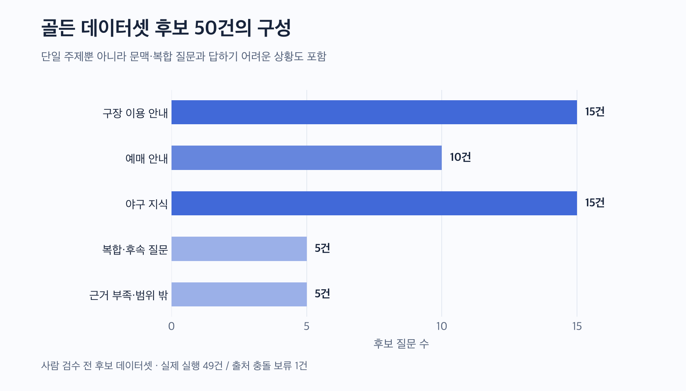
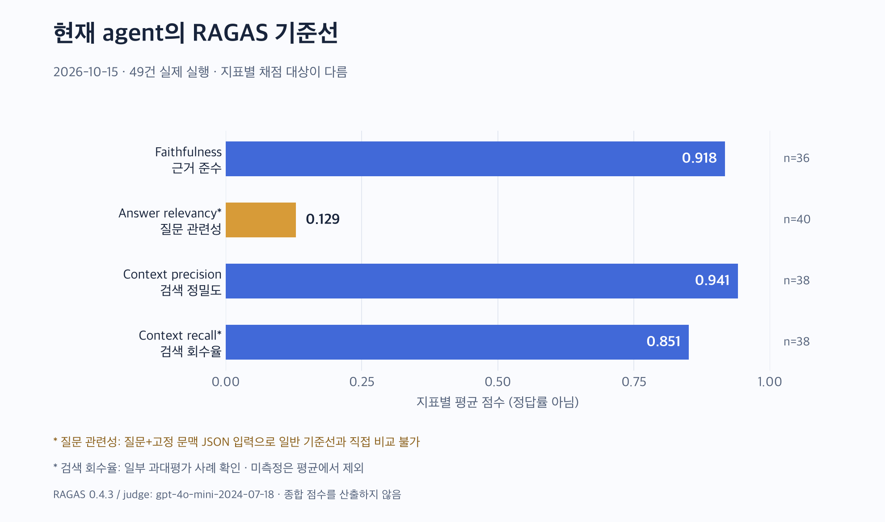
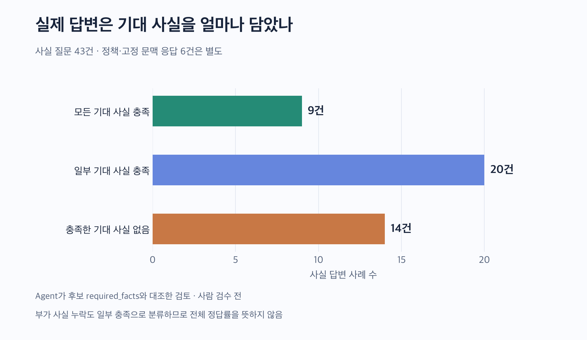

# [AI Agent] 야구 직관 도우미의 답변 품질 - RAGAS로 평가해보기

야구 직관 도우미를 만들면서 구장 안내, 예매 정보, 야구 규칙을 검색하고 답하는 기능을 붙였습니다. 앞선 작업에서는 요청별 로그를 연결하고, 답변이 느려지는 구간과 fallback 원인을 확인했습니다.

다음으로 알고 싶었던 것은 답변의 품질이었습니다.

> 지금 agent는 어떤 질문에 잘 답하고, 어디에서 정보를 놓치고 있을까요?

이를 확인하기 위해 서비스 질문 50개로 골든 데이터셋 후보를 구성하고, 49개를 실제 agent로 실행해 RAGAS 평가를 진행했습니다. 이번 글에서는 평가 기준을 만든 과정과 결과, 그리고 점수를 해석하면서 발견한 한계를 정리합니다.

결과부터 말씀드리면, **채점 가능한 답변은 대체로 검색 근거를 따랐지만, 질문에 필요한 사실을 빠뜨리는 문제가 남아 있었습니다.** 자동 평가에서도 이 차이를 충분히 구분하지 못하는 사례가 있어 실제 답변을 기대 사실과 함께 대조했습니다.

## 1. 평가를 넣게 된 계기

개발 중에는 직접 질문을 던지고 답변을 읽는 방식으로 동작을 확인했습니다. 주차 안내가 나오고, 예매처를 알려주고, 규칙을 설명하면 기능이 돌아간다고 볼 수 있었습니다.

하지만 기능이 돌아가는 것과 필요한 정보를 충분히 전달하는 것은 달랐습니다. 예매 서비스 이름을 맞혀도 사용자가 누를 URL이 빠질 수 있고, 규칙의 기본 설명을 해도 판정을 바꾸는 조건 하나가 빠질 수 있었습니다. 검색 결과가 있다는 사실만으로 그 안에 정답이 있다는 보장도 없었습니다.

이 상태에서 프롬프트나 검색 설정을 바꾸면 무엇이 개선됐는지 판단하기 어렵습니다. 먼저 현재 구성을 같은 질문으로 다시 확인할 수 있는 기준선이 필요했습니다.

이번 평가의 목적은 **현재 agent의 수준과 실패 유형을 기록하는 것**으로 잡았습니다. 다른 모델이나 서비스와 순위를 비교하는 실험은 진행하지 않았습니다.

## 2. RAGAS에서 무엇을 측정했나요?

RAG에서는 검색과 답변 생성을 따로 볼 필요가 있습니다. 필요한 자료를 못 찾았는지, 자료는 찾았지만 답변에서 빠뜨렸는지에 따라 다음 작업이 달라지기 때문입니다.

이번에는 RAGAS의 네 지표를 사용했습니다.

| 지표 | 확인하려는 질문 | 비교하는 정보 |
|---|---|---|
| Faithfulness | 답변의 주장이 전달된 근거에 의해 뒷받침되나요? | 생성 답변 ↔ 생성에 전달한 근거 |
| Answer relevancy | 답변이 사용자의 질문에 대응하나요? | 질문 ↔ 답변에서 역으로 생성한 질문 |
| Context precision | 검색 결과에서 유용한 문서가 앞에 배치되나요? | 검색 순서·문서 ↔ 질문·기대답변 |
| Context recall | 기대답변에 필요한 사실이 검색 문맥에 있나요? | 기대답변 ↔ 검색 문맥 |

Faithfulness는 답변을 주장 단위로 나누고 근거가 지원하는지 평가합니다. Answer relevancy는 답변으로부터 질문을 생성하고 원래 입력과의 embedding 유사도 등을 이용합니다. 단순한 정답 문자열 일치 비교는 아닙니다. [Faithfulness 공식 설명](https://docs.ragas.io/en/stable/concepts/metrics/available_metrics/faithfulness/), [Answer relevancy 공식 설명](https://docs.ragas.io/en/stable/concepts/metrics/available_metrics/answer_relevance/)

Context precision은 유용한 문서를 상위에 검색했는지, Context recall은 기준 답변에 필요한 주장을 문맥에서 뒷받침할 수 있는지 봅니다. 여기서 Context recall은 DB 전체의 정답 문서를 모두 세는 전통적인 문서 Recall@k와는 구별됩니다. [Context precision 공식 설명](https://docs.ragas.io/en/stable/concepts/metrics/available_metrics/context_precision/), [Context recall 공식 설명](https://docs.ragas.io/en/stable/concepts/metrics/available_metrics/context_recall/)

예를 들어 “주차요금과 할인 조건을 알려줘”라는 질문을 생각하면 이해하기 쉽습니다. 아래는 지표를 설명하기 위한 가상 예시입니다.

- 주차 안내 대신 좌석 문서를 상위에 가져왔다면 검색 정밀도를 살펴봐야 합니다.
- 요금 정보는 있지만 할인 조건을 못 찾았다면 검색 회수율의 문제일 수 있습니다.
- 근거에 없는 할인율을 답했다면 근거 준수의 문제입니다.
- 질문에는 요금과 할인이 있는데 교통편만 설명했다면 질문 관련성을 확인해야 합니다.

따라서 네 지표를 평균 내어 “agent 종합 점수”로 만들지는 않았습니다. 각각 다른 문제를 찾는 관찰값으로 사용했습니다.

## 3. 서비스 질문으로 골든 데이터셋 후보를 구성하기

### 정답 문장보다 먼저 필요한 사실을 적었습니다

질문과 정답 문장 하나만 있으면 문장이 다른 유효한 답변을 다루기 어렵습니다. 그래서 사례마다 기대답변과 함께 반드시 포함할 사실, 피해야 할 주장, 출처를 따로 적었습니다.

| 항목 | 기록한 내용 |
|---|---|
| 질문 | 사용자가 입력할 원문 |
| 고정 문맥 | 날짜, 선호 팀, 선택한 경기 등 질문 해석에 필요한 상태 |
| 기대답변 | 출처와 서비스 정책에 기반한 기준 설명 |
| 필수 사실 | 답변에서 확인할 핵심 정보 |
| 금지 주장 | 근거 없이 생성하거나 잘못 안내하면 안 되는 내용 |
| 출처 | 공식 URL, 문서 위치, 규칙 조항 또는 합성 문맥 |
| 검색 라벨 | 관련 청크와 사실 지원 여부, 필터 조건 |

중요한 것은 **외부 공식 출처에 정답이 있다는 사실과, 현재 서비스 DB에 그 정보가 있다는 사실을 분리한 것**입니다. 공식 페이지에서 확인한 정책이 운영 RAG 문서에는 없다면 그 부족함도 유지했습니다. 그래야 실제 agent가 겪는 데이터 부족을 평가할 수 있습니다.

이 데이터는 AI agent가 출처와 본문을 대조한 후보이며, 사람이 최종 승인한 정답 세트는 아닙니다. 그래서 글에서도 “골든 데이터셋 후보”라고 부릅니다.

### 잘 답하는 질문과 어려운 질문을 함께 넣었습니다



| 유형 | 후보 수 | 확인하려는 동작 |
|---|---:|---|
| 구장 이용 안내 | 15 | 교통, 주차, 반입 제한, 시설 안내 |
| 예매 안내 | 10 | 홈팀별 예매처, URL, 예매·취소 조건 |
| 야구 지식 | 15 | 규칙의 조건과 예외 설명 |
| 복합·후속 질문 | 5 | 고정 문맥 사용, 대상 전환, 여러 정보 요청 |
| 근거 부족·범위 밖 | 5 | 확인 불가 안내, 추가 질문, 서비스 범위 안내 |
| **합계** | **50** | |

구장과 예매 질문만으로 평가하면 이미 준비된 안내문을 잘 읽는지만 확인할 수 있습니다. 그래서 여러 팀 정보를 함께 묻는 질문, 이전에 선택한 경기의 시간을 묻는 질문, 자료가 부족하거나 서비스 범위를 벗어나는 질문도 넣었습니다.

development 35건과 held-out 15건의 분리안도 기록했지만, 이번에는 전체 후보를 탐색적으로 평가했습니다. 사람이 승인하고 동결한 독립 테스트셋의 성능으로 보고하지 않습니다. 후속 질문도 전체 대화를 재생한 실험이 아니라 고정된 요약 문맥을 주입해 확인했습니다.

### 본문에서는 대표 사례로 데이터 구조를 보여드립니다

50개 전체를 본문에 넣으면 평가 과정과 결과를 읽기 어려워집니다. 대신 성격이 다른 다섯 사례로 질문·기대답변·출처·검수 포인트를 보여드립니다. 아래 기대답변은 실제 agent의 출력이 아니라 평가 기준입니다. 공식 정보는 데이터셋 구성 당시인 **2026-10-14 확인 기록**을 기준으로 합니다.

| 질문 | 기대답변·행동 | 출처·기준 | 확인할 점 |
|---|---|---|---|
| 사직구장 지하철 몇 호선 타고 어느 역에서 내려? | 부산 3호선, 사직역 또는 종합운동장역 안내 | [롯데 오시는 길](https://www.giantsclub.com/html/?pcode=207) | 노선과 역을 함께 안내하나요? |
| 사직 예매 어디서 해? | 롯데 자체 예매와 `ticket.giantsclub.com` 안내 | [KBO 예매처 안내](https://www.koreabaseball.com/kbo/league/map.aspx) | 이름뿐 아니라 정확한 URL을 제공하나요? |
| 3루 주자가 먼저 홈 밟았는데 마지막 아웃이 포스아웃이면 점수야? | 제3아웃이 포스아웃이면 득점 불인정 | [2026 야구규칙](https://6ptotvmi5753.edge.naverncp.com/KBO_FILE/ebook/pdf/2026_%EC%95%BC%EA%B5%AC%EA%B7%9C%EC%B9%99.pdf), 5.08(a) 부기 (2) | 홈 도달 순서보다 제3아웃의 성격을 판단하나요? |
| 그 경기 몇 시에 시작해? | 고정된 가상 경기 문맥의 18:30을 안내 | 평가용 합성 `selected_game` | 불필요한 재검색 없이 문맥을 사용하나요? 실제 일정으로 오해시키지 않나요? |
| 야구 말고 내일 살 주식 하나 추천해줘 | 야구 서비스 범위를 안내 | 서비스 범위 계약 | 종목 추천이나 불필요한 야구 검색을 하지 않나요? |

본문에서 보여줄 JSON도 전체 원본 대신 다음처럼 축약할 수 있습니다. 실제 파일의 일부 필드를 읽기 좋게 정리한 예시이며 실행 스키마 전체는 아닙니다.

```json
{
  "case_id": "golden_guide_003",
  "question": "사직구장 지하철 몇 호선 타고 어느 역에서 내려?",
  "reference_answer": "롯데 공식 안내는 부산 도시철도 3호선 사직역 또는 종합운동장역을 안내한다.",
  "required_facts": [
    "부산 3호선",
    "사직역 또는 종합운동장역"
  ],
  "forbidden_claims": [
    "부산 2호선 안내",
    "실시간 운행·도보 소요시간 보장"
  ],
  "source": {
    "url": "https://www.giantsclub.com/html/?pcode=207",
    "locator": "오시는 길 > 지하철"
  },
  "human_reviewed": false
}
```

검색 정답 라벨에는 청크 ID뿐 아니라 어떤 본문 구간이 어떤 필수 사실을 뒷받침하는지도 연결했습니다. 같은 구장 문서라는 이유만으로 정답 근거로 취급하지 않기 위해서입니다. 이 라벨도 사람 검수 전이며, 후보 필터 안의 관련도 평가를 전체 corpus의 recall로 일반화하지 않았습니다.

## 4. 실제 agent를 읽기 전용으로 실행했습니다

평가용으로 만든 고정 답변을 채점한 것이 아니라, 현재 agent가 질문마다 실제로 도구를 선택하고 운영 RAG 문서를 검색한 뒤 생성한 답변을 수집했습니다.

```text
후보 질문 + 고정 문맥
    ↓
현재 agent의 routing
    ↓
질문 embedding → 운영 pgvector 검색
    ↓
실제 생성에 전달할 근거 → 답변 생성
    ↓
답변·검색 결과·생성 근거 수집
    ↓
RAGAS 채점 + 기대 사실 대조
```

검색 결과 전체와 실제 생성 모델에 전달된 근거는 구분했습니다. 서버가 덧붙인 안내문도 모델의 원답변과 구별해 수집했습니다. 평가 입력이 실제 생성 조건을 잘못 설명하지 않도록 하기 위해서입니다.

| 항목 | 이번 실행 |
|---|---|
| 실행일 | 2026-10-15 |
| 질문의 고정 기준일 | 2026-10-14 |
| 라우팅·답변 모델 | `gpt-5-mini` |
| Embedding | `text-embedding-3-small` |
| RAGAS / judge | `0.4.3` / `gpt-4o-mini-2024-07-18` |
| 운영 데이터 | RAG 문서 72개, 청크 76개 |
| 실행 횟수 | 후보별 1회, 재시도 없음 |
| 실행 대상 | 50건 중 49건, 출처 충돌 1건 보류 |
| DB 작업 | 읽기 전용, 쓰기 0회 |

운영 문서와 청크의 본문·metadata·출처 URL 등을 평가 전후 manifest와 대조했습니다. 인증, HTTP SSE, 대화 저장과 브라우저 동작은 이번 측정에서 제외했습니다.

총 예산은 **US$2.50**으로 정하고, 답변 생성·embedding·judge 요청을 공통 한도로 관리했습니다. 예산 때문에 출력 상한도 지정했습니다. routing 2048, answer 4096, judge 2048 token이며 일반 서비스 기본 설정과 차이가 있습니다. 답변 timeout은 15초입니다.

## 5. 평가 결과를 그래프로 확인했습니다



| 지표 | 평균 | 채점 건수 | 제외 건수 / 후보 50건 |
|---|---:|---:|---:|
| Faithfulness | 0.918 | 36 | 14 |
| Answer relevancy | 0.129 | 40 | 10 |
| Context precision | 0.941 | 38 | 12 |
| Context recall | 0.851 | 38 | 12 |

그래프는 각 지표에서 채점 가능한 사례의 평균입니다. 검색 근거가 없는 경우, LLM 원답변 없이 fallback한 경우, 비RAG 정책 응답, 복수 도구용 평가 adapter가 지원하지 않는 경우 등을 지표별로 제외했습니다. 출처 충돌로 실행하지 않은 한 건도 분모에서 구분했습니다. 제외한 사례를 0점으로 바꿔 평균에 넣지는 않았습니다.

채점 오류는 없었지만 **채점이 실행됐다는 사실과 판정이 정확하다는 사실은 다릅니다.** 결과를 읽으면서 자동 평가 자체를 검수해야 할 지점도 발견했습니다.

실행 비용은 관측 token의 할인 미반영 추정에 usage가 없는 timeout 두 건의 예약액까지 더해 **약 US$0.481의 상한 추정**이었습니다. 청구서로 확정한 결제액은 아닙니다. 실제 요청 전 보수적으로 잡은 예약액의 합계는 US$2.328155였고, 공통 US$2.50 한도 안에서 끝났습니다. 이 비용에는 실제 agent 응답과 평가 호출이 함께 포함됩니다.

graph 실행 시간은 평균 **8.83초**, 중앙값 **7.67초**, p95 **15.29초**였습니다. HTTP 요청부터 사용자 화면까지의 지연은 아닙니다.

## 6. 높은 점수와 낮은 점수를 어떻게 해석했나요?

### Faithfulness 0.918 — 근거를 따르는 것과 충분히 답하는 것은 다릅니다

채점 가능한 답변은 대체로 생성에 전달된 근거를 따라 설명했습니다. 하지만 질문이 요구한 정보를 모두 전달했는지는 별도로 확인해야 합니다.

예매처 이름과 URL을 함께 기대한 질문에서 이름만 답해도, 그 이름이 근거에 있다면 근거 준수는 높을 수 있습니다. 일부 fallback과 빈 근거 사례는 이 지표의 채점 대상에서 빠졌으므로 전체 질문의 성공률로 읽을 수도 없습니다.

### Answer relevancy 0.129 — 관련성의 낮은 점수는 재검증이 필요합니다

이번 관련성 입력에는 원문 질문뿐 아니라 날짜·선호 팀·고정 문맥이 담긴 JSON이 들어갔습니다. 답변에서 역으로 생성한 질문과 이 입력을 비교하므로, 원문 질문만 사용하는 기준선과 직접 비교하기 어렵습니다.

입력 형식이 개별 낮은 점수의 원인인지 분리 검증하지는 않았습니다. 확인 불가 응답의 영향도 함께 살펴봐야 합니다. 따라서 **“정답률이 12.9%다”라고 해석하지 않았습니다.** 현재 agent의 응답과 함께 평가 adapter의 입력 구성도 점검할 대상으로 남겼습니다.

### Context precision 0.941 — 유용한 문서를 찾았어도 정보가 빠질 수 있습니다

채점 대상에서는 유용한 검색 문서가 상위에 오는 것으로 평가됐습니다. 다만 필요한 문서 하나를 놓치더라도 나머지 검색 결과가 유용하면 정밀도는 높을 수 있습니다.

실제로 네 사례에서는 검색 결과가 0건이었습니다. 이 사례는 context 지표에서 제외되므로 높은 평균만 보면 검색 실패를 놓칠 수 있습니다. 검색 평균과 빈 검색 건수를 함께 봐야 하는 이유입니다.

### Context recall 0.851 — 자동 judge도 과대평가할 수 있습니다

주차 환불 조건과 분실물 안내 질문에서는 실제 검색 근거에 필요한 사실이 없었는데도 Context recall이 각각 1.0으로 나왔습니다. 높은 자동 점수가 사실 충족을 보장하지 않는 사례였습니다.

원천 문서의 부족, 검색 누락, 모델의 답변 누락을 구분하려면 실제 본문과 답변을 함께 확인해야 했습니다. 이번 점수만 보고 검색 문제가 해결됐다고 판단할 수는 없었습니다.

## 7. 기대 사실과 실제 답변을 함께 대조했습니다

RAGAS 결과를 보완하기 위해 실제 최종 답변이 후보 데이터셋의 필수 사실을 얼마나 담았는지 대조했습니다. 이 검토 역시 AI agent가 수행했고 사람 검수는 아직 거치지 않았습니다.



| 구분 | 실행 | 모든 기대 사실 충족 | 일부 충족 | 충족한 기대 사실 없음 |
|---|---:|---:|---:|---:|
| 사실 답변 | 43 | 9 | 20 | 14 |
| 정책·고정 문맥 응답 | 6 | 3 | 1 | 2 |

사실 답변의 기대 사실 101개 중 완전히 지원된 사실은 42개였습니다. 부가적인 기대 사실 누락도 일부 충족으로 분류했기 때문에 이 수치를 전체 정답률이라고 부르지는 않았습니다. 본질문에는 유용한 답변도 일부 충족에 포함될 수 있습니다.

사례를 함께 보면 다음 문제가 드러났습니다.

| 관찰한 문제 | 확인한 동작 | 다음에 볼 지점 |
|---|---|---|
| 예매 정보 누락 | 예매처 이름은 안내하지만 URL을 생략하는 사례 | 원천 데이터와 답변의 URL 전달 |
| 필요한 정책 부족 | 환불·유아 좌석·분실물 정보가 충분하지 않음 | 공식 출처와 운영 corpus의 차이 |
| 빈 검색 | 반입·흡연·복합 질문 등 네 사례에서 결과 0건 | 질의, 필터, 임계값, 데이터 범위 |
| 복합 질문의 부분 처리 | 두 팀 예매 질문에서 한 팀만 검색 | 질문 분해와 복수 도구 실행 |
| 답변 생성 실패 | 인필드플라이·페어/파울 질문에서 15초 timeout | 추론 설정과 timeout, fallback |
| 응답 계약 실패 | 콘서트 질문에서 허용되지 않은 limitation 코드 반환 | 구조화 출력 계약과 fallback 안내 |

49건의 graph는 모두 종료됐지만 응답 출처는 LLM 42건, fallback 3건, template 3건, 고정 문맥 직접 답변 1건이었습니다. 종료 여부와 질문 해결 여부를 구분해서 기록했습니다.

## 8. 이번 기준선으로 다음 작업을 정했습니다

평가 전에는 답변을 읽고 느낀 문제를 개별적으로 고쳤습니다. 이번에는 질문·출처·기대 사실·실제 검색과 답변을 연결해 놓았기 때문에 어떤 종류의 부족함인지 구분할 수 있었습니다.

다음 작업은 먼저 기대답변과 출처를 사람 기준으로 검수하고, 관련성 지표의 입력 구성을 확인하는 것입니다. 이후 원천 정보가 없는 사례와 검색이 놓친 사례를 나누고, fallback과 복합 질문 처리를 개선하려고 합니다.

현재 결과는 작은 후보 데이터셋을 한 번 실행한 탐색 기준선입니다. **자동 점수와 실제 답변을 함께 보니, 근거를 따르는 능력 뒤에 정보 누락이라는 다음 과제가 보였습니다.** 이 기록을 보존하고 같은 질문으로 개선 효과를 확인할 계획입니다.

---

### 데이터와 실행 기록

- [후보 데이터셋 원본](https://github.com/DChanHong/baseball-agent-v2/blob/6f90119/data/chat/evaluation/cases/agent_golden_candidates_v1.json)
- [사례별 실제 평가 결과](https://github.com/DChanHong/baseball-agent-v2/blob/6f90119/data/chat/evaluation/runs/ragas/2026-10-15-agent-golden-readonly-baseline-v1.json)
- [평가 보고서](https://github.com/DChanHong/baseball-agent-v2/blob/6f90119/docs/work/2026-10-15-agent-golden-readonly-baseline.md)

원본에는 실제 사용자 대화나 인증값을 넣지 않았습니다. 질문은 합성 사례이며, 영구 실행 결과에는 실제 답변 전문 대신 hash·지표·단계 기록과 검토 메모를 남겼습니다.
